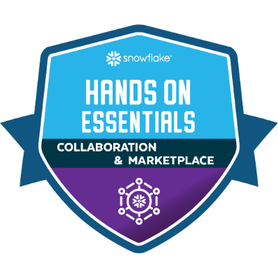

# Snowflake Hands On Essentials: Collaboration, Marketplace & Cost Estimation Workshop (Badge 2)

## Achievement

  

  🏅 <strong>Completed 19 November 2026</strong>

  <a href="https://achieve.snowflake.com/48e3569a-ea94-4486-b6c3-650cf10e50ba#acc.X3YpiHZP">View Credential</a>

## Repository Contents

This repository contains my SQL scripts which I completed as part of a Collaboration, Marketplace & Cost Estimation Workshop.

Key topics covered:
- Creating and getting listing from other accounts
- shopping for datasets on Snowflake Marketplace
- Improving ETL processes to improve efficiency
- Cost categories, estimation and cost control mechanisms

This was a challenging workshop, with the need to keep track, create code for and maintain multiple accounts as you work from both the data provider and the data consumer during the collaboration tasks. I found Snowflake Marketplace a great resource for datasets and has got me thinking about different projects I can set up exploring end-to-end products from data exploration, analysis using SQL and then developing dashboards for the final product.

